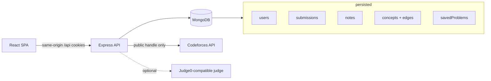

# AlgoForge

**Your code. Your patterns. Your next move.**

**Live app:** [https://algoforge-eta.vercel.app](https://algoforge-eta.vercel.app)  
**Demo:** [https://youtu.be/cOEDCl7El-0](https://youtu.be/cOEDCl7El-0)  
**API health:** [https://algoforge-eta.vercel.app/api/health](https://algoforge-eta.vercel.app/api/health)  
**Database:** MongoDB Atlas is connected in production (`/api/health` reports `"db":"connected"`, `"inMemoryDb":false`).

[](https://youtu.be/cOEDCl7El-0)

AlgoForge is a personal programming environment for competitive programmers. It turns public Codeforces history into a practice map: what you have solved, where you struggled, which techniques connect, and what is worth attempting next — plus a vault for lessons written in your own words.

It is not a generic contest tracker. The loop is:

**Connect coding history → Analyse practice → Explore concepts → Solve problems → Record lessons → Improve recommendations.**

## Who it is for

People who already solve problems on Codeforces and want a private place to organise that history, keep technique notes, and get explainable next-problem suggestions.

## What works today

- **Accounts** — email/password registration and login, HttpOnly session cookies, protected routes, logout, persistent sessions.
- **Themes** — After Dark, Dreamscape, and Daylight. Same data, different design tokens. Switching never resets state.
- **Codeforces** — connect a public handle (never a password). Imports profile, submissions, verdicts, tags, ratings, and contest rating history via the official API. Incremental sync; duplicates are impossible by unique `(user, platform, submission id)`.
- **Signals dashboard** — facts, computed statistics, and inferred practice signals are labelled separately. Topic drill-down. Empty and failed-sync states.
- **Problem library** — search the shared Codeforces catalogue, save/bookmark/revisit, filter by topic and rating, open the original statement on Codeforces (we do not scrape statements).
- **Technique Vault** — personal notes with technique and post-mortem fields. Create, search, edit, delete. Ownership is enforced on the server.
- **Knowledge graph** — curated DSA concepts and typed, explained edges stored in MongoDB. Interactive SVG graph, prerequisite traversal, linked notes and problems.
- **Next move** — deterministic, unit-tested ranking with a visible score breakdown. No LLM.
- **Workspace** — C++ / Java / Python editor and per-problem drafts. Isolated execution only if `JUDGE0_URL` is configured; otherwise Run explains that it is unavailable. Local runs are not official verdicts.

## Stack

| Layer | Choice |
| --- | --- |
| Frontend | React 19, TypeScript, Vite, React Router |
| Backend | Node.js, Express, TypeScript |
| Database | MongoDB (Mongoose) |
| Tests | Vitest, Testing Library, Supertest, Playwright |
| Deploy | Vercel Services (Vite frontend + Express API) |

## Architecture



The API owns authentication, Codeforces normalisation, statistics, graph traversal, and recommendations. The client is a themed shell over those endpoints.

## Local setup

Requires **Node.js 22+**. MongoDB is optional locally.

```bash
git clone https://github.com/HotaroOreki-art/AlgoForge.git
cd AlgoForge
npm install
cp .env.example .env   # optional — see below
npm run dev
```

Then open [http://localhost:5173](http://localhost:5173). Vite proxies `/api` to the Express server on port 4000.

If `MONGODB_URI` is unset in development, the API starts a local MongoDB via `mongodb-memory-server` and stores files under `.data/mongo` (gitignored) so accounts survive restarts. Tests always use an ephemeral in-memory database.

### Environment variables

Copy `.env.example`. Never put real secrets in source control.

| Variable | Required | Purpose |
| --- | --- | --- |
| `MONGODB_URI` | Production | MongoDB connection string. Optional in development. |
| `JWT_SECRET` | Production | Session signing secret, ≥ 16 characters. |
| `SERVER_PORT` | No | API port. Default `4000`. |
| `CLIENT_ORIGIN` | Split origins only | Comma-separated CORS allow-list. Leave empty for same-origin deploys. |
| `COOKIE_SECURE` | No | Force `Secure` cookies. Defaults to true in production. |
| `LOG_LEVEL` | No | pino level. |
| `DEV_DB_PATH` | No | Where the fallback MongoDB stores files. Empty string = purely in-memory. |
| `JUDGE0_URL` | No | Enables workspace Run. |
| `JUDGE0_KEY` / `JUDGE0_HOST` | No | RapidAPI (or similar) credentials for Judge0. |

## Scripts

```bash
npm run dev          # API + Vite together
npm run build        # production client build
npm run typecheck    # server + client
npm run lint
npm test             # Vitest unit + integration + frontend
npm run test:e2e     # Playwright against the running app
```

Server-only: `npm run test -w server`. Client-only: `npm run test -w client`.

## Testing

- **Unit** — Codeforces normalisation and dedupe, statistics, recommendation scoring, graph traversal, password rules, output comparison, UI helpers.
- **Integration** — auth cookies, ownership of notes, problem library, Codeforces sync (fake API), graph and recommendation endpoints. Uses `mongodb-memory-server`, never a production database.
- **Frontend** — login/register validation, theme switching without resetting state, library query building.
- **E2E** — register → empty dashboard → theme → vault note that survives reload → graph node → logout; bad login; unknown Codeforces handle.

A live Codeforces import is exercised in the browser against a real handle when the API is reachable; automated e2e uses an unknown handle so it does not depend on a huge public history.

## Deployment

The repo is set up as a **Vercel Services** project (beta): a Vite frontend and an Express backend behind one URL.

**Production:** [https://algoforge-eta.vercel.app](https://algoforge-eta.vercel.app) — Express API on the same origin, MongoDB Atlas as the database.

To deploy your own copy:

1. Create a MongoDB Atlas database and copy the connection string.
2. Set production environment variables: `MONGODB_URI`, `JWT_SECRET` (and `JUDGE0_*` only if you want execution).
3. Deploy with the Vercel CLI or a connected Git repository.

Same-origin `/api` means cookies work without `CLIENT_ORIGIN`. Leave that variable empty on the single-URL deploy.

Health check: `GET /api/health`.

Source: [github.com/HotaroOreki-art/AlgoForge](https://github.com/HotaroOreki-art/AlgoForge). Atlas credentials live in Vercel env vars and a local gitignored `.env` — they are not committed.

## Known limitations

- Only Codeforces is integrated. Other platforms are out of scope for this version.
- Problem statements are not stored; AlgoForge links to the original page.
- The workspace does not run code unless a Judge0-compatible service is configured. Sample runs are not official hidden tests.
- A single sync fetches at most 8,000 newest submissions (Codeforces pacing). Very large accounts can continue with another sync.
- Recommendation quality depends on an imported history **and** a loaded problem catalogue (Connect page).
- Server-side rate limits are per instance (fine for a single-region deploy).

## Next improvements

1. Configure Judge0 (or equivalent) and verify isolated C++/Java/Python runs.
2. Paginate remaining Codeforces history beyond the first 8,000 submissions.
3. Add a second platform only after Codeforces incremental sync stays boringly reliable.
